<p align="center">
  
</p>

<p align="center">
  <a href="https://jose-andres-toro-narvaez.netlify.app"></a>&nbsp;&nbsp;
  <a href="https://www.linkedin.com/in/jose-andres-toro-narvaez"></a>&nbsp;&nbsp;
  <a href="mailto:joantoro64@gmail.com"></a>
</p>

## Sobre mí

Soy desarrollador Full Stack con más de 5 años en desarrollo y análisis de software con **Java, Spring Boot, Angular y Oracle**. Trabajo en una plataforma transaccional de alcance nacional, donde atiendo incidentes en producción, optimizo procesos críticos e integro servicios de pagos y de datos.

Llevo la IA a productos reales: integro modelos en producción y construyo agentes con modelos de lenguaje. Busco roles **Full Stack o Backend Java 100 % remotos**, en Colombia o el exterior.

```java
public class JoseAndresToro {

    String   rol         = "Desarrollador Full Stack";
    String   experiencia = "Más de 5 años";
    String[] core        = { "Java", "Spring Boot", "Angular", "Oracle" };
    String   enfoque     = "Sistemas transaccionales en producción + IA aplicada";
    String   ubicacion   = "Cali, Colombia (UTC−5)";
    String   modalidad   = "100 % remoto";
    String[] idiomas     = { "Español (nativo)", "Inglés (A2, en formación)" };

    boolean disponible() { return true; } // disponibilidad inmediata
}
```

## Resultados en producción

<p align="center">
  
</p>

## Proyecto destacado

<p align="center">
  <a href="https://jose-andres-toro-narvaez.netlify.app"></a>
</p>

**[JOSÉ·IA](https://jose-andres-toro-narvaez.netlify.app)** responde solo con información verificada y con guardarraíles de privacidad. Tiene holograma 3D, voz y dictado, un analizador que compara una vacante con mi perfil y un recorrido 3D narrado por las fábricas. Todo corre en el navegador, sin IA externa.

## Trayectoria

<details open>
<summary><b>Desarrollador Full Stack</b> · CODESA · abr 2025 – actual · Cali, Colombia (híbrido)</summary>
<br>

- Parte de la célula que responde por producción en una plataforma transaccional de alcance nacional del sector de juegos de suerte y azar: análisis de logs, causa raíz y hotfixes a master y UAT (≈60 incidentes al mes).
- Optimización de procesos críticos en Oracle y Spring Boot: rediseño de tablas, índices, lógica y endpoints para actualizar solo los registros afectados (de unos 20 minutos a aplicación inmediata).
- Uno de los responsables del diseño y desarrollo del módulo de reportes con JasperReports; participación en la reportería de Baloto.
- Requerimientos full stack de alta complejidad con Angular (microfrontends) y Spring Boot, en equipo SCRUM con JIRA.

`Java 11` `Spring Boot` `Angular` `Oracle` `PL/SQL` `JasperReports` `Git / GitLab` `Docker`

</details>

<details>
<summary><b>Desarrollador Power Platform</b> · Auto Control Empresarial (España) · ene 2024 – mar 2025 · remoto</summary>
<br>

- Automatización de procesos internos con Power Apps y Power Automate; uno pasó de 1 hora de trabajo manual a 3 minutos.
- Aplicaciones internas y para clientes, integradas con otros sistemas por APIs REST y SOAP.
- Nuevas funcionalidades, mantenimiento de aplicaciones en producción y capacitación a usuarios.

`Power Apps` `Power Automate` `Dataverse` `REST` `SOAP`

</details>

<details>
<summary><b>Desarrollador Full Stack</b> · CODESA · abr 2022 – dic 2023 · Cali, Colombia (híbrido)</summary>
<br>

- Construcción de una nueva plataforma transaccional de alcance nacional: microservicios en Spring Boot, APIs REST, comunicación entre servicios con Feign Client y microfrontends en Angular con PrimeNG.
- Cobro de comisiones en pagos con Nequi de punta a punta: configuración por rangos (tarifa fija o porcentaje), cálculo en el carrito, persistencia e integración con la API de Nequi.
- Integración del modelo de recomendaciones del equipo de datos al flujo de venta: persistencia, consumo de la API e interfaz en Angular.
- Implementación de seguridad y pruebas funcionales.

`Java 11 / 8` `Spring Boot` `Angular` `TypeScript` `PrimeNG` `JPA / Hibernate` `Oracle`

</details>

<p><b>Práctica SENA · Desarrollo de software</b> · CODESA · abr 2021 – oct 2021 · Cali, Colombia</p>

## Stack

<p align="center">
  
</p>

## Formación

- **Tecnólogo en Análisis y Desarrollo de Sistemas de Información** · SENA · Cali, Colombia · 2019 – 2021
- **Cursos:** Angular de cero a experto (2025) · Microservicios con Spring Boot y Spring Cloud Netflix Eureka · Oracle PL/SQL · Spring Boot · Java 8 · Hibernate y JPA · SQL
- **Idiomas:** español nativo · inglés A2, en formación

<details>
<summary><b>English summary</b></summary>
<br>

Full Stack Developer with 5+ years in software development and analysis with **Java, Spring Boot, Angular and Oracle**. I work on a nationwide transactional platform, where I handle production incidents, optimize critical processes and integrate payment and data services. I bring AI into real products: I integrate models into production and build agents on language models.

- Redesigned the sales-limits process: a change that reprocessed up to 200,000 records in about 20 minutes now applies instantly.
- Handle about 60 production incidents a month, from log analysis to the hotfix on master and UAT.
- Built commission charging for Nequi payments end to end.
- Integrated the data team's recommendation model into the sales flow.
- Automated an internal process from 1 hour of manual work to 3 minutes.

Looking for fully remote Full Stack or Java Backend roles, in Colombia or abroad. Available immediately. English: A2, currently studying.

</details>

## Contacto

<p align="center">
  Abierto a roles <b>Full Stack o Backend Java 100 % remotos</b>, en Colombia o el exterior · Disponibilidad inmediata
</p>

<p align="center">
  <a href="https://jose-andres-toro-narvaez.netlify.app">jose-andres-toro-narvaez.netlify.app</a> ·
  <a href="https://www.linkedin.com/in/jose-andres-toro-narvaez">LinkedIn</a> ·
  <a href="mailto:joantoro64@gmail.com">joantoro64@gmail.com</a>
</p>

<p align="center">
  
</p>
